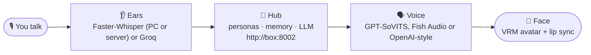

<picture>
  <source width="100%" srcset="./docs/banner-dark.png" media="(prefers-color-scheme: dark)" />
  <source width="100%" srcset="./docs/banner-light.png" media="(prefers-color-scheme: light), (prefers-color-scheme: no-preference)" />
  
</picture>

<h1 align="center">Project Riko</h1>

<p align="center">
  <b>Talk to her out loud. She talks back.</b><br />
  An anime AI companion that runs on your own PC, with her own voice and a 3D avatar that lip-syncs every word.
</p>

<p align="center">
  <a href="https://www.youtube.com/@JustRayen"></a>
  <a href="https://patreon.com/RayenAI"></a>
  <a href="https://discord.gg/rayenai"></a>
</p>
<p align="center">
  
  
  
  
  <a href="LICENSE"></a>
</p>

> [!IMPORTANT]
> **This is the 50K snapshot: a complete Riko, open source and yours to keep.** It's frozen at this release, so it stays a stable base to build on.
>
> Riko keeps growing on **[Patreon](https://patreon.com/RayenAI)**, home of the Full Source and the Desktop App. [See how they compare.](#three-ways)
>
> GitHub issues aren't monitored, so there's no support here.

## 🦊 Meet Riko

Riko is a voice companion you set up yourself. Press Enter and talk. She hears you, comes up with a reply (usually a snarky one), and says it out loud while her lips move along on screen.

This repo is the open-source core of Project Riko: the whole loop from your voice to hers, written to be read. Every part on your PC sits in its own small file, so when you want to change how she hears, sounds or looks, you know exactly where to go.

Her head — personas, memory, which LLM to think with — is a small server called the **hub**, so any app (this one, a phone, a web page) shares the same Riko. The parts on your PC are ears, mouth and a face.

## ✨ What she can do

| | |
|---|---|
| 🎙️ **Listens** | Push-to-talk. Press Enter, speak, press Enter. Or just type to her. |
| 👂 **Understands** | Speech to text with [Faster-Whisper](https://github.com/SYSTRAN/faster-whisper) on your own PC, on a second machine with a GPU (see [Remote ears](#remote-ears)), or [Groq](https://console.groq.com)'s fast online Whisper. |
| 🧠 **Thinks** | Her brain is the **hub**: any OpenAI-compatible server (vLLM, llama.cpp, LM Studio, Ollama, OpenAI itself), reached over a small HTTP API the hub owns. |
| 📝 **Remembers** | Chat history lives on the hub, not on your PC: browse it, edit it or wipe it from her web page. |
| 🗣️ **Speaks** | Clones a voice from a short clip with [GPT-SoVITS](https://github.com/RVC-Boss/GPT-SoVITS), uses any voice on [Fish Audio](https://fish.audio/?fpr=rayen10), or any OpenAI-style `/audio/speech` server. `tts: none` skips her voice and shows a speech bubble instead. |
| 💃 **Shows up** | A VRM avatar in your browser that lip-syncs to her voice. Drag to spin her around, right-drag to move her, scroll to zoom. |
| 🪟 **Lives on your desktop** | On Linux she can also run as a small borderless, transparent, always-on-top window, no browser involved: `uv run desktop.py` ([Desktop pet](#desktop-pet)). |
| 🎭 **Becomes anyone** | Multiple **personas** on the hub — personality, avatar, greeting and voice each. Switch from her web page, the tray menu, or `riko-ctl persona asuka`; she changes her whole body live, no reload. |
| ✅ **Tells you what's missing** | Before she starts, a quick check catches a missing key, server or file and tells you how to fix it. |

## ⚙️ How it works



The hub keeps her head — the persona list, each persona's avatar, the chat history, the LLM settings — and serves a web page at `http://<box>:8002` where you edit all of it. Your PC runs the body: it records you, ships the text to the hub, plays the answer through TTS and her avatar. The hub can run **on this same PC** (`hub.mode: local`, no Docker involved) or on any machine on your LAN (`hub.mode: remote`).

Each step is one file, and `main.py` / `desktop.py` run them in a loop:

| Step | File | What it does |
|---|---|---|
| 👂 Ears | `riko/asr.py` | Records you between the two Enters, turns it into text |
| 🧠 Head | `riko/hub_client.py` | Talks to the hub: chat, personas, history, avatar download; can even start the hub inside this process |
| 🗣️ Voice | `riko/tts.py` | Turns her answer into a voice clip (or a plain bubble with `tts: none`) |
| 💃 Face | `riko/viewer.py` + `client/index.html` | Serves the avatar page and her active persona's body, plays the clip, moves her mouth with it |

## 🚀 Quick start

Pick a shape first:

| | 🏠 **All on one PC** | 🖥️ **Client + server** |
|---|---|---|
| The hub runs | inside this app (`hub.mode: local`) | in Docker on a Linux box (`hub/`) |
| Her ears | your PC (`asr: local`) | a GPU box (`asr: remote`, see [Remote ears](#remote-ears)) |
| Good for | trying her out right now | her living on the same GPU box as your LLM and ears, phones/apps joining later |

**You need:** a Windows or Linux PC with a microphone, somewhere for her to think (an [OpenAI API key](https://platform.openai.com/api-keys), or any [OpenAI-compatible server](#the-hub) running), and — for the easiest voice — a [Fish Audio API key](https://fish.audio/?fpr=rayen10) (sign up, then create one under *API keys*).

**1. Install uv.** It sets up Python for you.

```powershell
# Windows (PowerShell)
powershell -ExecutionPolicy ByPass -c "irm https://astral.sh/uv/install.ps1 | iex"
```

```bash
# Linux
curl -LsSf https://astral.sh/uv/install.sh | sh
sudo apt install libportaudio2    # lets Python use your microphone
```

Close and reopen your terminal afterwards so it can find `uv`.

**2. Get the code.**

```bash
git clone https://github.com/rayenfeng/riko_project.git
cd riko_project
```

No git? Click the green **Code** button at the top of this page → **Download ZIP**, unzip it, then open a terminal in that folder. On Windows 11: right-click inside the folder → **Open in Terminal**.

**3. Install everything.**

```bash
uv sync
```

**4. Add your API keys.**

```bash
copy .env.example .env    # Linux: cp .env.example .env
notepad .env              # Linux: nano .env
```

Paste your keys after the `=` signs and save. `.env` is git-ignored, so your keys stay out of any commit. `RIKO_HUB_KEY` is the token the client uses to talk to the hub — make one up; in server mode the hub's own `.env` must carry the same value.

**5a. All on one PC (local mode).** In `character_config.yaml` set `hub.mode: local` — that's it. The app starts the hub inside itself on `127.0.0.1:8002` and keeps her head in `hub_data/` (git-ignored). The `llm:` block is where her hub starts; after the first run you change the brain on the web page, not in the file.

```bash
uv run main.py --tts fish
```

**5b. Client + server (remote mode).** Leave `hub.mode: remote` and `hub.url` pointed at your Linux box. On that box (Docker + [NVIDIA container toolkit](https://docs.nvidia.com/datacenter/cloud-native/container-toolkit/latest/install-guide.html) for the GPU parts):

```bash
# her head — from this repo's hub/ directory
# (cp -a hub/. copies dotfiles too — .env.example, .dockerignore. hub/data/
#  is her live state; don't drag a stale copy over — rm -rf it after copying,
#  or use: rsync -a --exclude data/ hub/ ~/AI/Docker/riko-hub/)
mkdir -p ~/AI/Docker/riko-hub && cp -a hub/. ~/AI/Docker/riko-hub/ && cd ~/AI/Docker/riko-hub
cp .env.example .env      # set RIKO_HUB_KEY (same value as on your PC), RIKO_LLM_BASE_URL and RIKO_LLM_API_KEY
docker compose up -d

# her ears — from this repo's server/ directory (skip if asr: local)
# (same deal: don't copy a leftover server/data/ or server/.venv/)
mkdir -p ~/AI/Docker/riko-asr && cp -a server/. ~/AI/Docker/riko-asr/ && cd ~/AI/Docker/riko-asr
cp .env.example .env      # set ASR_API_KEY
docker compose up -d
```

Then on your PC: `uv run main.py`. Both containers have their own `.env` and data folder; the hub's page lives at `http://<box>:8002`.

**6. Say hi.**

1. Open **http://127.0.0.1:8080** and click once. Browsers only play sound after a click.
2. Back in the terminal, press **Enter**, say something, press **Enter**.
3. She answers on the page. **Ctrl+C** quits.

> [!TIP]
> Set `tts: fish` in `character_config.yaml` and a plain `uv run main.py` does the same thing.

> [!NOTE]
> Coming from the old version? Your `chat_history.json` doesn't move by itself: `uv run -m riko.migrate` uploads it to the hub's active persona and renames the file so it never imports twice (`--prompt` also copies your old `system_prompt` into that persona).

## 🎨 Make her yours

Half of her lives in `character_config.yaml` on your PC — her ears, her voice, the window. The other half lives on the hub: open **http://&lt;box&gt;:8002** (local mode: http://127.0.0.1:8002) and edit her head in the browser.

**On the hub's web page:**

| To change her... | Edit |
|---|---|
| **Personality** | The persona's `system_prompt`. Describe her the way you'd brief an actor: who she is, how she talks, what she calls you. |
| **Look** | The persona's avatar — upload any `.vrm` file. You can make your own for free in [VRoid Studio](https://vroid.com/en/studio). The avatar page swaps her body live, no reload. |
| **Greeting & keywords** | Each persona has a greeting she says when she becomes active, and keywords that summon her (see [Switching characters](#personas)). |
| **Her voice name** | A persona's `tts_voice` picks the voice on OpenAI-style TTS servers; empty falls back to `openai_tts.voice` in your local config. |
| **Brain** | Which OpenAI-compatible server and model she thinks with — same fields as the `llm:` block, edited live. |
| **Memory** | The chat history: read it, edit a message, wipe it. |

**On your PC** (`character_config.yaml`, restart to apply):

| To change her... | Edit |
|---|---|
| **Where her head lives** | The `hub:` block: `mode: local` to run it inside the app, or `mode: remote` + `url` for the hub server. `api_key_env` names the `.env` variable holding the hub key (`RIKO_HUB_KEY`). |
| **Fish voice** | `fish.voice_id`. Open any voice on [fish.audio](https://fish.audio/?fpr=rayen10) and copy the ID from the page address: `fish.audio/m/<voice id>`. |
| **GPT-SoVITS voice** | `ref_audio_path`: a 3–10 second clip with no long silences. `prompt_text`: exactly what the clip says. |
| **Ears** | `asr: local` (Faster-Whisper, free, on your PC), `asr: remote` (Faster-Whisper on [another machine](#remote-ears)) or `asr: groq` (needs a free [Groq key](https://console.groq.com/keys)). |
| **Voice** | `tts: none` (bubble only), `openai` (any `/audio/speech` server, see `openai_tts:`), `sovits` or `fish`. |
| **Speech model size or GPU** | `local_asr.model` / `local_asr.device` in `character_config.yaml`. |
| **A fresh start** | `riko-ctl forget`, or the wipe button on the hub page. |

You can also switch voice or ears for one run without touching the config:

```bash
uv run main.py --tts fish        # or sovits, openai, none
uv run main.py --asr groq        # or local, remote
uv run main.py --type            # type your messages instead of using a mic
```

<a id="personas"></a>
## 🎭 Switching characters

The hub can hold any number of personas — Riko, Asuka, whoever you write. One is *active*: her personality, her body, her greeting. Four ways to change it, all of them instant:

| How | Do |
|---|---|
| **Web page** | Pick the persona on `http://<box>:8002`. |
| **Say it** | "switch to asuka", "become riko", or just her keyword ("riko-chan"). The hub matches the switch itself — every client understands it, and she greets you in her new body. |
| **`riko-ctl`** | `riko-ctl personas` lists them; `riko-ctl persona asuka` switches (by name, id or keyword); `riko-ctl persona-next` cycles to the next one. |
| **Tray menu** | Desktop app: right-click the tray icon → *Persona*. |

Whatever route a switch takes, the avatar page notices within about three seconds: she downloads the new `.vrm`, reuses the file next time (versioned cache), disposes the old body and swaps in the new one — no page reload, and the greeting lands in the bubble.

<a id="the-hub"></a>
## 🧠 The hub

The hub is a small FastAPI server (see `hub/`, endpoints in [docs/API.md](docs/API.md)). It keeps the personas, their avatars, the chat history and the LLM settings, and speaks one versioned HTTP API with a bearer key. Every client — terminal, desktop, later a phone app — talks that same API, so they all share one head: switch the persona from your phone and the desktop avatar changes too.

Her *brain* is whatever OpenAI-compatible server the hub is configured with: vLLM, llama.cpp, LM Studio, Ollama in OpenAI mode, OpenAI itself. In `hub.mode: local` the app seeds it from this file on first start:

```yaml
llm:
  base_url: http://192.0.2.51:8000/v1   # your server; https://api.openai.com/v1 for OpenAI
  api_key_env: LLM_API_KEY   # the .env variable holding the key; leave it empty if the server needs none
  model: auto                # "auto" = the first model the server lists at /v1/models
```

After the first start those settings live on the hub — edit them on its web page. `model: auto` means you can swap the model on the server without touching Riko. Reasoning models spend part of their budget thinking, so `max_tokens` should leave headroom (1024 is a safe default), and the clients wait up to 180 s per reply.

<a id="remote-ears"></a>
## 👂 Remote ears

If your desktop PC has no GPU but another machine does, run her ears there. The microphone still records on your desktop; only the audio clip travels over your LAN.

On the GPU machine:

```bash
cd server
uv sync
uv run --extra cuda asr_server.py --device cuda   # NVIDIA (pulls the cuBLAS/cuDNN wheels)
uv run asr_server.py                              # or plain CPU
```

It listens on port 8001 with an OpenAI-compatible `/v1/audio/transcriptions` endpoint, so any OpenAI STT client works against it too. Set `ASR_API_KEY=secret` there to require a bearer token.

**Docker.** On a machine with an NVIDIA driver and [nvidia-container-toolkit](https://docs.nvidia.com/datacenter/cloud-native/container-toolkit/latest/install-guide.html) installed, the same server is one command:

```bash
cd server
docker compose up -d          # builds the image, downloads the model on first start
docker compose logs -f        # watch it come up
```

The model lands in `server/data/models` on the host and is reused by later containers. Put `ASR_MODEL=...` in `server/.env` (see `server/.env.example`) to change the model; everything else about the deployment (API key, port) lives there too. For a machine without an NVIDIA GPU: `docker compose -f compose.yaml -f compose.cpu.yaml up -d`.

On the desktop PC set `asr: remote` in `character_config.yaml` and point `remote_asr.url` at that machine (put the same token in `.env` as `ASR_API_KEY` if you set one). If the ears server is down, Riko says so at startup and keeps working: voice fails, typing doesn't.

<details>
<summary>Local ears (no second machine)</summary>

`asr: local` runs Faster-Whisper on your own PC. Pick the model and device under `local_asr:` (`device: cuda` needs CUDA + cuDNN installed); the CPU runs fine with `base.en` or `small.en`.

</details>

<a id="local-voice"></a>
## 🎤 Local voice with GPT-SoVITS

Want her voice generated on your own machine, cloned from any clip you like? That's what GPT-SoVITS does. It runs best on an NVIDIA GPU and is installed separately.

1. Install [GPT-SoVITS](https://github.com/RVC-Boss/GPT-SoVITS) by following its guide.
2. In the GPT-SoVITS folder, start its API server and leave it running:
   ```bash
   python api_v2.py -a 127.0.0.1 -p 9880
   ```
3. Start Riko with `uv run main.py --tts sovits`.

She starts with the sample voice in `character_files/main_sample.wav`. Swap in your own clip (see the table above) to change it.

<a id="desktop-pet"></a>
## 🪟 Desktop pet (Linux)

Instead of a browser tab, she can live in a small borderless, transparent, always-on-top window on your desktop: `uv run desktop.py` (or `bin/riko-desktop`). It's the same page and the same loop, rendered by QtWebEngine, with the desktop showing through everywhere except her.

**In the window**

| Do | With |
|---|---|
| Move her around the screen | Left-drag anywhere (under Hyprland) |
| Pan / rotate / zoom the camera | Shift-drag / right-drag / scroll |
| Type to her | Press `/` or **Enter**, type, **Enter** to send, **Esc** to give up |
| Push-to-talk | Hold **Space**, speak, release |
| Quit | **Ctrl+Q**, the tray menu, or `riko-ctl quit` |

**From anywhere else:** `bin/riko-ctl <command>` talks to the running app over its local port — `type` (open her input and focus the window), `talk` / `talk-start` / `talk-stop`, `show` / `hide` / `toggle`, `status`, `forget`, `personas`, `persona <name>`, `persona-next`, `quit`. Handy in a keybinding or a script.

**Window rules.** `desktop.py` asks Hyprland to float, size and pin her on its own. For best results add the shipped rules so it happens the instant she maps:

```lua
-- Hyprland 0.55+ (Lua config): add to hyprland.lua, or copy into windowrules.lua / keybinds.lua
dofile(os.getenv("HOME") .. "/Development/riko_project/desktop/hyprland/riko.lua")
```

```ini
# classic hyprland.conf: source it and fix $RIKO
source = ~/Development/riko_project/desktop/hyprland/riko.conf
```

The shipped files also wire global shortcuts: **Ctrl+Alt+T** type to her, hold **Ctrl+Alt+Space** to talk, **Ctrl+Alt+H** show/hide, **Ctrl+Alt+P** cycle to the next persona. They stay off the Super key on purpose (your WM lives there) — but they're only suggestions: check `hyprctl binds` for clashes and pick other keys if needed. Window size and bubble time are under `desktop:` in `character_config.yaml`.

To start her with the session, copy `desktop/riko.desktop` to `~/.config/autostart/` (or launch `bin/riko-desktop` from your compositor's autostart). Outside Hyprland she still appears, but floating/sizing is left to your window manager, and true transparency needs a compositor.

> [!NOTE]
> Under Hyprland, do the float+size as a window rule if you can. Mapping her tiled and resizing the window afterwards can leave a black strip at the bottom of the web view (a long-standing QtWebEngine/Wayland resize bug).

<a id="three-ways"></a>
## 💎 Three ways to have Riko

Same Riko, three ways to have her. Each one is made for a different kind of person, so pick the one that matches how you like to work.

| | 🛠️ Open Source<br /><sub>this repo</sub> | 🧪 [Full Source](https://patreon.com/RayenAI)<br /><sub>on Patreon</sub> | 🖥️ [Desktop App](https://patreon.com/RayenAI)<br /><sub>on Patreon</sub> |
|---|---|---|---|
| **Made for** | Builders who want a clean base to make their own | Tinkerers who want every new feature and the code behind it | Anyone who wants her up and running, no code involved |
| **What you get** | This repo: open source, under 500 lines | The full source of the newest build | A Windows app with an installer and a desktop icon |
| Talks with a lip-synced VRM avatar | ✅ | ✅ | ✅ |
| Hears you | Faster-Whisper on your PC or on a LAN server, or Groq | Groq Whisper | Groq Whisper |
| Her voice | GPT-SoVITS voice clone or Fish Audio | GPT-SoVITS voice clone or Fish Audio | Both, switched in Settings, with automatic fallback |
| Conversation | Push-to-talk, easy to rewire | Hands-free: she can tell when you've finished | Hands-free, or type to her |
| Face and body | Lip sync, ready for your own animation system | Expressions and animations she picks herself | Expressions and animations she picks herself |
| Memory | Chat history on your hub, browsable and editable on its page | Long-term memory across sessions | Long-term memory you can browse, edit and reset |
| Doing things | Plug in your own tools | Tool calling with tools you write | Looks things up online when you ask |
| Backgrounds and anime scenes | A clean stage for your own | Drop in any 3D room, with lighting presets and a light editor | A clean stage, all eyes on her |
| Your own character | Edit one config file: avatar, voice, personality | Edit the config files: avatar, voice, personality, room | Guided in the app: drop in a VRM, pick a voice, write her personality |
| VR and desktop window | Transparent floating window on Linux (Hyprland) | Quest VR and a transparent floating window | Transparent floating window |
| Setup | `uv` and a terminal, with a setup checker | `setup.bat`, with a setup checker | One installer; keys tested on screen as you paste them |
| Runs on | Windows and Linux | Windows | Windows 10 / 11 |
| License | [MIT](LICENSE): fork it, change it, ship what you build | Personal use, full source included | Personal use; your videos and streams are yours |
| Updates | Stays at the 50K snapshot | New features as they land | Supported updates and bug fixes for version 1 |

<p align="center"><a href="https://patreon.com/RayenAI"><b>Get the Full Source or the Desktop App on Patreon →</b></a></p>

## 📋 Requirements

| | With Fish Audio (easiest) | With GPT-SoVITS (local voice) |
|---|---|---|
| **System** | Windows 10/11 or Linux | Windows 10/11 or Linux |
| **GPU** | Not needed | NVIDIA recommended |
| **Python** | 3.11+, installed by uv | 3.11+, installed by uv |
| **API keys** | LLM server key (`LLM_API_KEY`, or none for a local server) + Fish Audio | Same, no Fish key |
| **Also** | Microphone, speakers or headphones, a browser with WebGL, an internet connection | Same, plus a working GPT-SoVITS install |

Tested on Windows 11 and Ubuntu 22.04 (WSL2) with an RTX 3060 12 GB. Faster-Whisper runs on the CPU, so any modern processor handles the ears.

**Where the keys come from**

| Key | When | Get it |
|---|---|---|
| `RIKO_HUB_KEY` | always — the client's bearer key for the hub (`hub.api_key_env` says the name) | anything you choose, shared with the hub (`RIKO_HUB_KEY` in the hub server's `.env`) |
| `LLM_API_KEY` | local mode only: this PC's `.env` variable that seeds the hub's LLM settings on first start (`llm.api_key_env` says the name). In remote mode the hub reads its own `RIKO_LLM_API_KEY` from the hub server's `.env`, not this one | your server (or [platform.openai.com](https://platform.openai.com/api-keys) for OpenAI) |
| `ASR_API_KEY` | `asr: remote` and the ears server was started with a key | anything you choose, shared with `server/asr_server.py` |
| `TTS_API_KEY` | `tts: openai`, if that server needs a key | that server |
| `GROQ_API_KEY` | `asr: groq` | [console.groq.com](https://console.groq.com/keys) (free tier) |
| `FISH_API_KEY` | `tts: fish` | [fish.audio](https://fish.audio/?fpr=rayen10) |

## 🩹 Troubleshooting

| You see | Try this |
|---|---|
| `[setup] OPENAI_API_KEY is missing` (or another key) | Add it to `.env`. Check the file is called exactly `.env`, not `.env.txt`. |
| `can't reach the hub at http://...` | The hub is down or the URL is wrong. Local mode: is `hub_data/` writable, is port 8002 busy (another app on it → change `hub.local_port`)? Remote mode: on the hub box, `cd ~/AI/Docker/riko-hub && docker compose up -d`, then `curl http://<box>:8002/api/health` from your PC. |
| `the hub at ... rejected the key (401)` | `RIKO_HUB_KEY` in this PC's `.env` doesn't match the hub server's. The hub's key lives in its own `.env`; restart the container after changing it. |
| `GPT-SoVITS is not running` | Start its API server first (see [Local voice](#local-voice)), or run with `--tts fish`. |
| `Port 8080 is busy` | Riko is probably already running in another terminal. Close that one. |
| `the hub has no avatar for persona ...` | The active persona has no `.vrm` yet — upload one on the hub page. |
| She replies in the terminal, but there's no sound | Click the avatar page once. Browsers block sound until you do. |
| `no avatar page open, playing on speakers` | That's normal: with no page open she talks through your speakers. Open the page to see her. |
| `(heard nothing, try again)` | Make sure your mic is the default recording device, and talk a little longer. |
| `remote ASR not reachable ...` | Start `server/asr_server.py` on the ears machine (see [Remote ears](#remote-ears)), or switch to `asr: local`. Typing keeps working either way. |
| Desktop window: a black strip along the bottom | Your compositor resized her after she mapped. Add the [window rules](#desktop-pet) so she starts floated and sized. |
| Desktop window: she looks opaque | You need a running Wayland compositor (or X11 compositor) for transparency. |

## 🔧 Under the hood

```
main.py                the loop: record → transcribe → hub → speak → play
desktop.py             the floating desktop window (PySide6 + QtWebEngine, Linux)
riko/
  config.py            loads character_config.yaml and .env
  hub_client.py        the hub API: chat, personas, history, avatars; starts the hub in-process in local mode
  asr.py               push-to-talk recording + speech to text (local / remote / groq)
  tts.py               GPT-SoVITS, Fish Audio or OpenAI-style TTS → client/audio/riko.wav
  viewer.py            serves the avatar page, its events and the active persona's avatar (disk-cached)
  session.py           the turn queue shared by mic, typing and riko-ctl
  migrate.py           one-shot import of an old chat_history.json into the hub
client/
  index.html           three.js + three-vrm: the avatar, lip sync, persona swap, rotate and zoom
hub/                   the hub server itself (FastAPI; its deployment notes in docs/API.md)
server/
  asr_server.py        Faster-Whisper as a small HTTP server (her remote ears)
bin/
  riko-ctl             command the running app from anywhere (status / type / talk / persona / quit ...)
  riko-desktop         launcher for the desktop window
desktop/
  riko.desktop         launcher / autostart entry
  hyprland/            riko.lua + riko.conf: window rules and global shortcuts
character_files/       her sample voice (main_sample.wav); sample_avatar.vrm is spare, the avatar comes from the hub
character_config.yaml  hub location, ears, voice and window (personality lives on the hub now)
docs/
  DESIGN.md            the hub contract: objects, routes, auth (the hub's own docs: docs/API.md)
```

Every part also runs on its own, which helps when something isn't working:

```bash
uv run python -m riko.hub_client   # one test turn against your hub (check() + one chat)
uv run python -m riko.tts          # one voice line (add --fish for Fish Audio)
uv run python -m riko.asr          # record, then print what she heard
```

**Ideas if you want to build on it**

- **Hands-free listening.** Replace `record()` in `riko/asr.py` with something that notices when you stop talking.
- **Emotions.** `client/index.html` already opens her mouth with `vrm.expressionManager.setValue('aa', ...)`. Expressions like `happy` and `angry` work the same way.

## 🙏 Credits

- Voice by [GPT-SoVITS](https://github.com/RVC-Boss/GPT-SoVITS) and [Fish Audio](https://fish.audio/?fpr=rayen10)
- Speech recognition by [Faster-Whisper](https://github.com/SYSTRAN/faster-whisper) and [Groq](https://groq.com)
- Language model by [OpenAI](https://platform.openai.com)
- Avatar rendering by [three.js](https://threejs.org) and [three-vrm](https://github.com/pixiv/three-vrm)
- Sample avatar by [pixiv Inc.](https://github.com/pixiv/three-vrm) (VRM1_Constraint_Twist_Sample)

## 📄 License

[MIT](LICENSE). Feel free to clone, modify, and build your own waifu voice companion.
