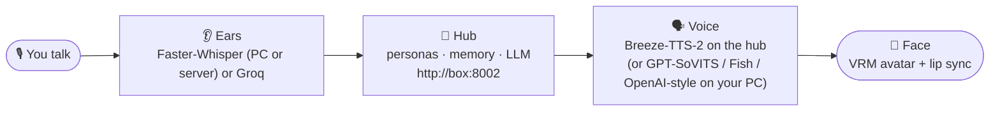

<picture>
  <source width="100%" srcset="./docs/banner-dark.png" media="(prefers-color-scheme: dark)" />
  <source width="100%" srcset="./docs/banner-light.png" media="(prefers-color-scheme: light), (prefers-color-scheme: no-preference)" />
  
</picture>

<h1 align="center">Project Riko</h1>

<p align="center">
  <b>Talk to her out loud. She talks back.</b><br />
  An anime AI companion that runs on your own PC, with her own voice and a 3D avatar that lip-syncs every word.
</p>

<p align="center">
  <a href="https://www.youtube.com/@JustRayen"></a>
  <a href="https://patreon.com/RayenAI"></a>
  <a href="https://discord.gg/rayenai"></a>
</p>
<p align="center">
  
  
  
  
  <a href="LICENSE"></a>
</p>

> [!IMPORTANT]
> **This is the 50K snapshot: a complete Riko, open source and yours to keep.** It's frozen at this release, so it stays a stable base to build on.
>
> Riko keeps growing on **[Patreon](https://patreon.com/RayenAI)**, home of the Full Source and the Desktop App. [See how they compare.](#three-ways)
>
> GitHub issues aren't monitored, so there's no support here.

## 🦊 Meet Riko

Riko is a voice companion you set up yourself. Press Enter and talk. She hears you, comes up with a reply (usually a snarky one), and says it out loud while her lips move along on screen.

This repo is the open-source core of Project Riko: the whole loop from your voice to hers, written to be read. Every part on your PC sits in its own small file, so when you want to change how she hears, sounds or looks, you know exactly where to go.

Her head — personas, memory, which LLM to think with — is a small server called the **hub**, so any app (this one, a phone, a web page) shares the same Riko. The parts on your PC are ears, mouth and a face.

## ✨ What she can do

| | |
|---|---|
| 🎙️ **Listens** | Push-to-talk. Press Enter, speak, press Enter. Or just type to her. |
| 👂 **Understands** | Speech to text with [Faster-Whisper](https://github.com/SYSTRAN/faster-whisper) on your own PC, on a second machine with a GPU (see [Remote ears](#remote-ears)), or [Groq](https://console.groq.com)'s fast online Whisper. |
| 🧠 **Thinks** | Her brain is the **hub**: any OpenAI-compatible server (vLLM, llama.cpp, LM Studio, Ollama, OpenAI itself), reached over a small HTTP API the hub owns. |
| 📝 **Remembers** | Chat history lives on the hub, not on your PC: browse it, edit it or wipe it from her web page. |
| ⏰ **Comes back later** | "Remind me in 20 minutes to check the oven" sets a one-shot **timer** on the hub. When it fires she answers its prompt in the same chat, with the whole conversation as context — the desktop speaks it like a normal reply (⏰ chip on the web page). "Unless I get to it" works too: sending a message or opening that chat cancels it. Ask "what timers do I have?" or "cancel the tea timer" any time. |
| ⛅ **Knows the weather** | Set a **Location** on the hub's Settings page — type a place, pick a match — or give the server a `RIKO_LOCATION` default, and "will it rain tomorrow?" answers itself: the hub calls the free, keyless [Open-Meteo](https://open-meteo.com) APIs directly (no MCP server, no sign-up), caches for 10 minutes, takes "the weather in Tokyo" as a place name too, and speaks the numbers plainly ("14 degrees Celsius", "13 kilometres an hour"). Metric by default; `RIKO_UNITS=imperial` switches to °F / mph. |
| 🗣️ **Speaks** | Her voice lives on the **hub**: [Breeze-TTS-2](https://github.com/HoppouAI/Breeze-TTS-2.cpp) makes every persona sound different, designed from a text description or cloned from a short clip, all edited on the hub's web page. Clients just download the WAV — no TTS keys on your PC. (English and Chinese only; the weights and audio are non-commercial.) Prefer TTS on this PC? `tts: openai`, `sovits` or `fish` still work; `tts: none` shows a speech bubble instead. She never reads URLs or markdown aloud: the voice gets a cleaned *speech text* of the reply while links, code and details stay on screen. |
| 💃 **Shows up** | A VRM avatar in your browser: she blinks, breathes, looks around, follows your pointer, lip-syncs actual vowel shapes, waves hello, thinks with a hand on her chin and wears her emotion — see [Her animation](#animation). Drag to spin her around, right-drag to move her, scroll to zoom. |
| 🪟 **Lives on your desktop** | On Linux she can also run as a small borderless, transparent, always-on-top window, no browser involved: `uv run desktop.py` ([Desktop pet](#desktop-pet)). |
| 🏠 **Controls your home** | Hook the hub up to [Home Assistant](#home-assistant) and she turns on lights, sets the thermostat and checks the house — through HA's official MCP integration, with only the entities you expose. |
| 🎭 **Becomes anyone** | Multiple **personas** on the hub — personality, avatar, greeting and voice each. Switch from her web page, the tray menu, or `riko-ctl persona asuka`; she changes her whole body live, no reload. |
| ✅ **Tells you what's missing** | Before she starts, a quick check catches a missing key, server or file and tells you how to fix it. |

## ⚙️ How it works



The hub keeps her head — the persona list, each persona's avatar and voice, the chat history, the LLM settings — and serves a web page at `http://<box>:8002` where you edit all of it. By default the hub also *makes* her voice: it asks **Breeze-TTS-2** (`tts/`) to speak each reply in that persona's voice and hands the WAV to whoever asked, so the desktop app, a web page and a future phone app all hear the same voice. Your PC runs the body: it records you, ships the text to the hub, plays the answer and moves her avatar's mouth with it. The hub can run **on this same PC** (`hub.mode: local`, no Docker involved) or on any machine on your LAN (`hub.mode: remote`). Older ways — `tts: openai`, `sovits`, `fish` — still make the voice on your PC.

Each step is one file, and `main.py` / `desktop.py` run them in a loop:

| Step | File | What it does |
|---|---|---|
| 👂 Ears | `riko/asr.py` | Records you between the two Enters, turns it into text |
| 🧠 Head | `riko/hub_client.py` | Talks to the hub: chat, personas, history, avatar download; can even start the hub inside this process |
| 🗣️ Voice | `riko/tts.py` | Plays the voice clip the hub made (`tts: hub`), or runs TTS on this PC (`openai` / `sovits` / `fish`); no audio → a plain bubble |
| 💃 Face | `riko/viewer.py` + `client/index.html` | Serves the avatar page and her active persona's body, plays the clip, moves her mouth with it |

## 🚀 Quick start

Pick a shape first:

| | 🏠 **All on one PC** | 🖥️ **Client + server** |
|---|---|---|
| The hub runs | inside this app (`hub.mode: local`) | in Docker on a Linux box (`hub/`) |
| Her ears | your PC (`asr: local`) | a GPU box (`asr: remote`, see [Remote ears](#remote-ears)) |
| Good for | trying her out right now | her living on the same GPU box as your LLM and ears, phones/apps joining later |

**You need:** a Windows or Linux PC with a microphone and somewhere for her to think (an [OpenAI API key](https://platform.openai.com/api-keys), or any [OpenAI-compatible server](#the-hub) running). For a voice, either [the hub's Breeze voice](#her-voice) (no keys on your PC) or — the easiest way to get sound from a plain PC — a [Fish Audio API key](https://fish.audio/?fpr=rayen10) (sign up, then create one under *API keys*).

**1. Install uv.** It sets up Python for you.

```powershell
# Windows (PowerShell)
powershell -ExecutionPolicy ByPass -c "irm https://astral.sh/uv/install.ps1 | iex"
```

```bash
# Linux
curl -LsSf https://astral.sh/uv/install.sh | sh
sudo apt install libportaudio2    # lets Python use your microphone
```

Close and reopen your terminal afterwards so it can find `uv`.

**2. Get the code.**

```bash
git clone https://github.com/rayenfeng/riko_project.git
cd riko_project
```

No git? Click the green **Code** button at the top of this page → **Download ZIP**, unzip it, then open a terminal in that folder. On Windows 11: right-click inside the folder → **Open in Terminal**.

**3. Install everything.**

```bash
uv sync
```

**4. Add your API keys.**

```bash
copy .env.example .env    # Linux: cp .env.example .env
notepad .env              # Linux: nano .env
```

Paste your keys after the `=` signs and save. `.env` is git-ignored, so your keys stay out of any commit. `RIKO_HUB_KEY` is the token the client uses to talk to the hub — make one up; in server mode the hub's own `.env` must carry the same value.

**5a. All on one PC (local mode).** In `character_config.yaml` set `hub.mode: local` — that's it. The app starts the hub inside itself on `127.0.0.1:8002` and keeps her head in `hub_data/` (git-ignored). The `llm:` block is where her hub starts; after the first run you change the brain on the web page, not in the file.

```bash
uv run main.py --tts fish
```

**5b. Client + server (remote mode).** Leave `hub.mode: remote` and `hub.url` pointed at your Linux box. On that box (Docker + [NVIDIA container toolkit](https://docs.nvidia.com/datacenter/cloud-native/container-toolkit/latest/install-guide.html) for the GPU parts):

```bash
# her head — from this repo's hub/ directory
# (cp -a hub/. copies dotfiles too — .env.example, .dockerignore. hub/data/
#  is her live state; don't drag a stale copy over — rm -rf it after copying,
#  or use: rsync -a --exclude data/ hub/ ~/AI/Docker/riko-hub/)
mkdir -p ~/AI/Docker/riko-hub && cp -a hub/. ~/AI/Docker/riko-hub/ && cd ~/AI/Docker/riko-hub
cp .env.example .env      # set RIKO_HUB_KEY (same value as on your PC), RIKO_LLM_BASE_URL and RIKO_LLM_API_KEY
docker compose up -d

# her ears — from this repo's server/ directory (skip if asr: local)
# (same deal: don't copy a leftover server/data/ or server/.venv/)
mkdir -p ~/AI/Docker/riko-asr && cp -a server/. ~/AI/Docker/riko-asr/ && cd ~/AI/Docker/riko-asr
cp .env.example .env      # set ASR_API_KEY
docker compose up -d

# her voice — Breeze-TTS-2 on the same box (tts/; skip if you prefer TTS on your PC)
docker network create riko    # one-time: the private network hub <-> breeze
mkdir -p ~/AI/Docker/breeze-tts && cp -a tts/. ~/AI/Docker/breeze-tts/ && cd ~/AI/Docker/breeze-tts
# AMD/Intel GPU: cp .env.example .env, set VIDEO_GID/RENDER_GID, then
#   docker compose -f compose.yaml -f compose.amd.yaml up -d
docker compose up -d          # NVIDIA (CPU-only box: -f compose.yaml -f compose.cpu.yaml)
```

Then on your PC: `uv run main.py`. Each container has its own `.env` and data folder; the hub's page lives at `http://<box>:8002`. The hub finds Breeze at `http://breeze-tts:8137` on the `riko` network (its Settings page has the TTS section) — with both up, the default `tts: hub` needs no keys on your PC at all. Full notes: [Her voice](#her-voice) and `tts/README.md`.

**6. Say hi.**

1. Open **http://127.0.0.1:8080** and click once. Browsers only play sound after a click.
2. Back in the terminal, press **Enter**, say something, press **Enter**.
3. She answers on the page. **Ctrl+C** quits.

> [!TIP]
> Set `tts: fish` in `character_config.yaml` and a plain `uv run main.py` does the same thing.

> [!NOTE]
> Coming from the old version? Your `chat_history.json` doesn't move by itself: `uv run -m riko.migrate` uploads it to the hub's active persona and renames the file so it never imports twice (`--prompt` also copies your old `system_prompt` into that persona).

## 🎨 Make her yours

Half of her lives in `character_config.yaml` on your PC — her ears, her voice, the window. The other half lives on the hub: open **http://&lt;box&gt;:8002** (local mode: http://127.0.0.1:8002) and edit her head in the browser.

**On the hub's web page:**

| To change her... | Edit |
|---|---|
| **Personality** | The persona's `system_prompt`. Describe her the way you'd brief an actor: who she is, how she talks, what she calls you. |
| **Look** | The persona's avatar — upload any `.vrm` file. You can make your own for free in [VRoid Studio](https://vroid.com/en/studio). The avatar page swaps her body live, no reload. |
| **Greeting & keywords** | Each persona has a greeting she says when she becomes active, and keywords that summon her (see [Switching characters](#personas)). |
| **Her voice** | The persona's **Voice** panel (see [Her voice](#her-voice)): design one from a description, clone one from a clip, preview and lock it. A persona's `tts_voice` name is the older field for clients doing their own OpenAI-style TTS; empty falls back to `openai_tts.voice` in your local config. |
| **Brain** | Which OpenAI-compatible server and model she thinks with — same fields as the `llm:` block, edited live. |
| **Memory** | The chat history: read it, edit a message, wipe it. |
| **Hub TTS** | Settings → TTS: turn hub voice on/off and point it at Breeze (`http://breeze-tts:8137` by default). |

**Memory.** Long-term memory lives on the hub, past the chat logs: the page's
**Memory** tab is where you see, search, edit, pin and delete what she
remembers about you. Facts scoped *about you* are shared by every persona;
per-persona notes are private and vanish with the persona. She saves facts
herself when you tell her something lasting (or only when asked — Settings →
Long-term memory), and every reply that taught her something shows a 🧠 chip.
The **What you remember** block in her prompt is budgeted (Settings), pinned
facts always make it, and "forget everything" asks you to type the word.
Details in [docs/API.md — Memory](docs/API.md).

**On your PC** (`character_config.yaml`, restart to apply):

| To change her... | Edit |
|---|---|
| **Where her head lives** | The `hub:` block: `mode: local` to run it inside the app, or `mode: remote` + `url` for the hub server. `api_key_env` names the `.env` variable holding the hub key (`RIKO_HUB_KEY`). |
| **Fish voice** | `fish.voice_id`. Open any voice on [fish.audio](https://fish.audio/?fpr=rayen10) and copy the ID from the page address: `fish.audio/m/<voice id>`. |
| **GPT-SoVITS voice** | `ref_audio_path`: a 3–10 second clip with no long silences. `prompt_text`: exactly what the clip says. |
| **Ears** | `asr: local` (Faster-Whisper, free, on your PC), `asr: remote` (Faster-Whisper on [another machine](#remote-ears)) or `asr: groq` (needs a free [Groq key](https://console.groq.com/keys)). |
| **Voice** | `tts: hub` (the default — the hub's Breeze speaks and this PC just plays it, see [Her voice](#her-voice)); `none` (bubble only). The rest are **TTS on this PC**: `openai` (any `/audio/speech` server, see `openai_tts:`), `sovits` or `fish`. |
| **Speech model size or GPU** | `local_asr.model` / `local_asr.device` in `character_config.yaml`. |
| **A fresh start** | `riko-ctl forget`, or the wipe button on the hub page. |

You can also switch voice or ears for one run without touching the config:

```bash
uv run main.py --tts fish        # or sovits, openai, hub, none
uv run main.py --asr groq        # or local, remote
uv run main.py --type            # type your messages instead of using a mic
```

<a id="animation"></a>
## 💃 Her animation

She is never a statue. Everything that moves her lives in `client/js/` and runs on the
*normalized* VRM bones, so every gesture works on any persona — when you switch
characters she re-targets her whole repertoire onto the new body mid-motion.

- **Always alive** (`client/js/motion.js`): blinks (occasionally a double blink),
  breathes, makes small eye saccades every second or two, glances off to the side
  every 20-40 s, and slowly turns her head after where her eyes are going. She looks
  at the camera while listening or speaking, follows your pointer inside her window,
  and glances away when `embarrassed`.
- **Lip sync** (`client/js/gestures.js` + the WebAudio analyser): the voice clip's
  band energies pick a vowel shape — `aa / ih / ee / oh / ou` — with fast attack and
  softer release, so she mouths words instead of flapping.
- **Gestures**: wave — unmistakable raised-hand side-to-side — on app start, a
  persona switch, after 10+ minutes apart, whenever you greet or leave her
  (hi/bye/good morning/…), when her own reply opens with a greeting, and on
  demand (`W` or `riko-ctl wave`). An on-demand wave always plays right away:
  the 25 s greeting cooldown never swallows it and it blends out whatever else
  is mid-play (only an already-running wave makes it skip). When the desktop
  app starts, she says her persona's greeting out loud in a happy bubble
  riding that startup wave (`desktop.greet_on_start`, on by default).
  Hand-to-chin `think` with the elbow resting
  on her crossed left arm while she processes, lean-and-tilt `listen`, small
  open-hand talk gestures
  while speaking, and idle stretches / look-arounds / fidgets every 1-3 minutes.
  Cheap one-shots — nod, head shake, laugh, pout — punctuate her emotions. They are
  keyframed bone poses (probed against the shipped avatar), eased in and out with
  slerps from an arms-down rest, never the T-pose.
  `python3 client/tools/capture_frames.py think|wave <dir> <times>` renders them
  headless against the real sample avatar and prints pose measurements
  (hand-to-chin distance, hand height over shoulder, wave swing width).
- **The director** (`client/js/director.js`): a small state machine that decides
  *what* she does — a gesture never interrupts one already playing (the on-demand
  W wave is the one exception), each gesture has
  its own cooldown, and the whole thing is pure logic with unit tests
  (`node --test client/js/`).
- **Emotion**: the hub's `ChatResult.emotion` tag sets her face for the length of the
  line — happy, angry, sad, embarrassed (eyes wandering off), surprised, thinking,
  teasing (head tilt) — plus the matching cheap gesture. No emotion from an older
  hub? She stays neutral.

**Want better gestures than my poses?** Drop a VRMA clip named `wave.vrma` (or
`think.vrma`, `listen.vrma`, ...) into `client/animations/` and it replaces the
built-in version, loaded through `@pixiv/three-vrm-animation` and re-targeted per
persona. Free clip sources: pixiv's VRM Animation Sample pack
(<https://booth.pm/ja/items/5512385> — free but needs a BOOTH login to download,
which is why nothing is bundled in the repo) and the VRoid Hub motion tag
(<https://hub.vroid.com/en/tags/4530169210384817001>). Check each pack's licence
before shipping it.

**She knows her body.** The page tells the desktop which gestures this body can
actually play (built-ins plus any `.vrma` drop-ins), and the desktop registers
that list with the hub as her body capabilities — drop in `curtsy.vrma` and she
can suddenly curtsy in replies. Ask for a move in your own words — *wave at me*,
*think about it*, *nod*, *stretch*… — and her reply performs it right away, cut
into the sentence at the tagged moment (`at × speech length`); an on-demand ask
bypasses cooldowns like the `W` key does. Actions she picks herself are polite:
they wait for her hands to be free and respect cooldowns. Appearance and
embodied settings (the body set she may use) live on the hub web page under
each persona. `python client/tools/actions_check.py` verifies the timing
headlessly.

<a id="personas"></a>
## 🎭 Switching characters

The hub can hold any number of personas — Riko, Asuka, whoever you write. One is *active*: her personality, her body, her greeting. Four ways to change it, all of them instant:

| How | Do |
|---|---|
| **Web page** | Pick the persona on `http://<box>:8002`. |
| **Say it** | "switch to asuka", "become riko", or just her keyword ("riko-chan"). The hub matches the switch itself — every client understands it, and she greets you in her new body. |
| **`riko-ctl`** | `riko-ctl personas` lists them; `riko-ctl persona asuka` switches (by name, id or keyword); `riko-ctl persona-next` cycles to the next one. |
| **Tray menu** | Desktop app: right-click the tray icon → *Persona*. |

Whatever route a switch takes, the avatar page notices within about three seconds: she downloads the new `.vrm`, reuses the file next time (versioned cache), disposes the old body and swaps in the new one — no page reload, and the greeting lands in the bubble.

<a id="the-hub"></a>
## 🧠 The hub

The hub is a small FastAPI server (see `hub/`, endpoints in [docs/API.md](docs/API.md)). It keeps the personas, their avatars, the chat history and the LLM settings, and speaks one versioned HTTP API with a bearer key. Every client — terminal, desktop, later a phone app — talks that same API, so they all share one head: switch the persona from your phone and the desktop avatar changes too.

Her *brain* is whatever OpenAI-compatible server the hub is configured with: vLLM, llama.cpp, LM Studio, Ollama in OpenAI mode, OpenAI itself. In `hub.mode: local` the app seeds it from this file on first start:

```yaml
llm:
  base_url: http://192.0.2.51:8000/v1   # your server; https://api.openai.com/v1 for OpenAI
  api_key_env: LLM_API_KEY   # the .env variable holding the key; leave it empty if the server needs none
  model: auto                # "auto" = the first model the server lists at /v1/models
```

After the first start those settings live on the hub — edit them on its web page. `model: auto` means you can swap the model on the server without touching Riko. Reasoning models spend part of their budget thinking, so `max_tokens` should leave headroom (1024 is a safe default), and the clients wait up to 180 s per reply.

The hub also runs her **timers** (see [docs/TIMERS.md](docs/TIMERS.md)): one-shot callbacks the model sets with a `timer` tool ("in 10 minutes", or an exact time). Fired turns go through the same chat path as anything you type, so they carry her voice, emotion and actions, and they never interrupt a turn in flight. Clients follow the hub's events stream to pick them up: the desktop speaks a fired reply for the persona it shows (another persona's timer is just a tray note), and tells the hub when you actually look at a chat, which cancels that persona's "unless I get to it" timers. Pending, fired and cancelled timers are listed on her web page, where you can cancel any of them.

<a id="home-assistant"></a>
## 🏠 Home Assistant

Riko can control your smart home through Home Assistant's official **Model Context Protocol Server** integration: she gets exactly the *Device control* toolset Assist has (`intent__HassTurnOn`, `light__HassLightSet`, `homeassistant__GetLiveContext`, …) over the integration's `/api/mcp/assist` endpoint, and only for the entities **you** expose. She is the voice assistant; Home Assistant is the hands — whatever you expose, she may use without asking (Settings > MCP on her page still lets you pin any tool to `ask` or `never`).

1. **In Home Assistant**: Settings > Devices & services > Add integration > **Model Context Protocol Server**, configured with your Assist pipeline's LLM API. Then expose the devices she may touch: Settings > Voice assistants > **Expose**.
2. **Create a long-lived access token**: your HA profile > Security > Long-lived access tokens. This is the only secret she needs.
3. **On the hub machine** put both into `~/AI/Docker/riko-hub/.env` and restart:
   ```bash
   RIKO_HA_URL=https://homeassistant.example.com   # your HA base URL
   RIKO_HA_TOKEN=ha_xxxxxxxxxxxxxxxxxxxxxxxxxxxxxx
   ```
   ```bash
   docker compose up -d
   ```
   With those two set, the hub offers a built-in `homeassistant` MCP server (Settings > MCP shows it with source *env*; edit or disable it there, reset returns it). The token itself never goes in the database, the web page or a chat — the saved header is just the text `Bearer ${RIKO_HA_TOKEN}`, expanded from the hub's environment at connect time. Set no token? MCP servers can reference any hub env var the same way: `${NAME}` in any header/env value.
4. **Try her**: *"turn on the kitchen light"*, *"what's the temperature in the living room?"*. Progress reads like *"turning on Kitchen light"*, and she says device names out loud — never entity ids.

<a id="remote-ears"></a>
## 👂 Remote ears

If your desktop PC has no GPU but another machine does, run her ears there. The microphone still records on your desktop; only the audio clip travels over your LAN.

On the GPU machine:

```bash
cd server
uv sync
uv run --extra cuda asr_server.py --device cuda   # NVIDIA (pulls the cuBLAS/cuDNN wheels)
uv run asr_server.py                              # or plain CPU
```

It listens on port 8001 with an OpenAI-compatible `/v1/audio/transcriptions` endpoint, so any OpenAI STT client works against it too. Set `ASR_API_KEY=secret` there to require a bearer token.

**Docker.** On a machine with an NVIDIA driver and [nvidia-container-toolkit](https://docs.nvidia.com/datacenter/cloud-native/container-toolkit/latest/install-guide.html) installed, the same server is one command:

```bash
cd server
docker compose up -d          # builds the image, downloads the model on first start
docker compose logs -f        # watch it come up
```

The model lands in `server/data/models` on the host and is reused by later containers. Put `ASR_MODEL=...` in `server/.env` (see `server/.env.example`) to change the model; everything else about the deployment (API key, port) lives there too. For a machine without an NVIDIA GPU: `docker compose -f compose.yaml -f compose.cpu.yaml up -d`.

On the desktop PC set `asr: remote` in `character_config.yaml` and point `remote_asr.url` at that machine (put the same token in `.env` as `ASR_API_KEY` if you set one). If the ears server is down, Riko says so at startup and keeps working: voice fails, typing doesn't.

<details>
<summary>Local ears (no second machine)</summary>

`asr: local` runs Faster-Whisper on your own PC. Pick the model and device under `local_asr:` (`device: cuda` needs CUDA + cuDNN installed); the CPU runs fine with `base.en` or `small.en`.

</details>

**Hearing the names right.** Whisper has never seen a name like *Furina*, so it spells what it hears: *Farina*. Three layers fix that, in every ear mode (remote, local, groq). **1. Vocabulary prompt:** every clip rides with a short `initial_prompt` — `'Riko, Furina, senpai.'` — and Whisper biases the *spelling* of the words it sees there. The hub's persona names are collected automatically (active persona first, cached ~5 min); add your own words under `asr.vocabulary:` in `character_config.yaml`. **2. Fix-ups:** finished transcripts run through `asr.corrections:` (case-insensitive whole-word, logged as `[asr] corrected Farina -> Furina`) plus a conservative fuzzy pass that only touches capitalised near-misses of your vocabulary words — *Marina* and *Farm* stay, *Asooka* becomes *Asuka*. The corrected text is what shows in the "heard" bubble and what she receives. **3. The safety net:** voice turns send `voice: true` with the chat (docs/API.md), so the hub adds a line telling her the text came from speech recognition and she must silently assume the closest name — never point out the misspelling. The ears server also accepts an optional `hotwords` form field (faster-whisper ≥ 1.1; it composes with `prompt`); the client uses the prompt alone, which every backend supports.

<a id="her-voice"></a>
## 🗣️ Her voice: hub voices with Breeze

Every persona gets her own voice **on the hub**, made by [Breeze-TTS-2.cpp](https://github.com/HoppouAI/Breeze-TTS-2.cpp) — a small C++/GGUF server that runs on NVIDIA, AMD and Intel GPUs through Vulkan. The desktop app just downloads the WAV the hub hands back, so *every* client (this app, the web page, a future Android app) hears the same voice with no TTS setup or keys of its own.

> [!IMPORTANT]
> Two licence/scope facts about Breeze: its **weights and the audio it produces are non-commercial** (personal use is fine), and it speaks **English and Chinese only**. If you need other languages or commercial rights, use one of the [TTS on this PC](#pc-tts) modes instead.

**Design or clone a voice** on the hub's web page, in the persona's **Voice** panel:

1. **Design** — describe her the way you'd brief a voice actor ("a proud, sharp teenage girl, fast and a little impatient"), pick a seed, hit **Preview**. The same seed keeps the same voice between requests.
2. **Clone** — upload a 3–30 s clip of the real voice plus its **exact transcript**.
3. **Lock this voice** — happy with a designed voice? One button renders it once, stores the result as the persona's reference and switches it to clone mode, so it can never drift again.

Each persona's audio is cached on the hub; her greeting is spoken too when she switches in.

**Run Breeze on the box** (`tts/`, one-time `docker network create riko`, then — on an NVIDIA box):

```bash
mkdir -p ~/AI/Docker/breeze-tts && cp -a tts/. ~/AI/Docker/breeze-tts/ && cd ~/AI/Docker/breeze-tts
docker compose up -d       # first start downloads the model (~3.3 GB) into tts/data/
```

AMD/Intel GPUs use `-f compose.yaml -f compose.amd.yaml` (set `VIDEO_GID`/`RENDER_GID` from `getent group video render`), CPU-only boxes `-f compose.yaml -f compose.cpu.yaml`. Model sizes, `BREEZE_MODEL`/`BREEZE_ARGS` and its optional web page: `tts/README.md`. GPU memory on the 16 GB AI box: ASR ~1.1 GB + Breeze q8_0 ~4 GB — plenty of room next to a quantised LLM.

**No Docker?** Run the release binary on one PC (works on AMD/Intel/NVIDIA via Vulkan) and point the hub's Settings → TTS base URL at `http://127.0.0.1:8137`:

```bash
./breeze-server breeze-tts-2-q8_0.gguf --port 8137 --voices-dir voices
```

If the hub's TTS is off or breeze is down, Riko says so once at startup and keeps working: her replies show as speech bubbles, typing and chatting are unaffected.

<a id="pc-tts"></a>
<details>
<summary><a id="local-voice"></a>TTS on this PC: GPT-SoVITS, Fish Audio or any OpenAI-style server</summary>

The other `tts:` modes make the audio **on your PC**, ignoring the hub's per-persona Breeze voice (except `openai`, which takes the persona's `tts_voice` name when set):

- **`tts: fish`** — [Fish Audio](https://fish.audio/?fpr=rayen10) online, needs `FISH_API_KEY`. The easiest way to get sound on a plain laptop. `fish.voice_id` picks any voice on the site.
- **`tts: sovits`** — clone a voice from a short clip with [GPT-SoVITS](https://github.com/RVC-Boss/GPT-SoVITS), free and local; runs best on an NVIDIA GPU.
  1. Install GPT-SoVITS by following its guide.
  2. In the GPT-SoVITS folder, start its API server and leave it running:
     ```bash
     python api_v2.py -a 127.0.0.1 -p 9880
     ```
  3. Start Riko with `uv run main.py --tts sovits`. She starts with the sample voice in `character_files/main_sample.wav`; swap in your own clip (`sovits.ref_audio_path` + the exact `prompt_text`) to change it.
- **`tts: openai`** — any OpenAI-compatible `/v1/audio/speech` server on your PC or LAN (Kokoro-FastAPI, speaches, …); see the `openai_tts:` block.
- **`tts: none`** — no voice at all, just her speech bubble.

</details>

<a id="desktop-pet"></a>
## 🪟 Desktop pet (Linux)

Instead of a browser tab, she can live in a small borderless, transparent, always-on-top window on your desktop: `uv run desktop.py` (or `bin/riko-desktop`). It's the same page and the same loop, rendered by QtWebEngine, with the desktop showing through everywhere except her.

**In the window (mouse)**

| Do | With |
|---|---|
| Move her around the screen | Left-drag anywhere (under Hyprland) |
| Size her up / down | Scroll over her — the window grows and shrinks with her, her feet staying put and the window clamped to the monitor (0.4×–2.5×, remembered per persona) |
| Camera close-up | Ctrl+scroll (the old zoom: a crop for close-ups) |
| Reset size + camera | Double-click her, or the tray's *Reset size* |
| Pan / rotate the camera | Shift-drag / right-drag |

**Keyboard shortcuts (in the window) — this is the way.** They are app-specific: they fire only while her window is focused, so they never fight your window manager. And they never touch the **Super/Meta/Win** key — that one is yours; a binding that uses it is rejected at startup with a warning. Change everything under `desktop.shortcuts:` in `character_config.yaml`.

| Do | Default key |
|---|---|
| Type to her | `/` or **Enter** — type, **Enter** sends, **Esc** gives up |
| Push-to-talk | Hold **Space**, speak, release to send |
| Always listen / back to push-to-talk | **L** (also the tray's *Always listen* tick) |
| She waves at you | **W** (always works: it cuts in, never waits on the greeting cooldown) |
| Next persona | **P** |
| Hide her | **H** (the tray icon brings her back) |
| Forget the chat | **Ctrl+Shift+Backspace**, press again within 3 s to confirm |
| Quit | **Ctrl+Q** (also in the tray menu) |

Keys are written as optional `Ctrl` / `Alt` / `Shift` modifiers plus one key name matching `KeyboardEvent.key` (letters — case doesn't matter — `Space`, `Enter`, `Escape`, `Backspace`, `Tab`, `F1`–`F12`, `/`). Use a list for several keys per action (`type: ["Enter", "/"]`), and `""` or `[]` to switch an action off. Typos, unknown keys and duplicate bindings are reported in the terminal at startup and ignored; anything you leave out keeps its default.

**Always listen.** Press **L** (or tick *Always listen* in the tray menu, or run `riko-ctl listen-mode`) and her ears go hands-free: instead of waiting for Space, a voice activity detector watches the mic continuously and sends each thing it hears — no *listening…* pill at all, she just answers. She ignores her own voice while she speaks, but the mic stream never closes and the VAD keeps seeing every frame, so when her audio ends the ears are back within a few hundred milliseconds (echo guard: `desktop.always_listen.echo_tail_ms`, default 200) — and anything you started saying during that echo tail is kept in a rolling pre-roll, not lost. Nothing goes to the turn unless the *evidence* says somebody spoke: Whisper's own per-segment confidence from `verbose_json` (redeploy `server/asr_server.py` if it predates segments) cross-checked with Silero's mean speech probability over the clip. There is no phrase blocklist — "Thank you." is a sentence, not a hallucination; only clips Whisper itself calls non-speech (or that Silero never believed) are dropped, quietly, without ever flashing a pill. Holding Space still works too, with the usual pill — a deliberate clip only needs a non-empty transcript. Whatever you pick is remembered across restarts (`desktop.listen_mode:` in `character_config.yaml` only seeds the first default). Privacy: in always mode the audio never leaves your PC until speech is actually detected — only finished utterances go to your ASR server. If the mic can't be opened, she says so once in the terminal and stays on push-to-talk. To watch the re-listen timing yourself: `uv run python client/tools/listen_timing_check.py` (headless; prints the audio-end → VAD-armed gap).

**Only when I say her name (optional name gate).** Tick **"Only when I say her name"** in the tray menu (right under *Always listen*, or run `riko-ctl listen name-gate on`) and always-listen mode stops answering the room: a VAD utterance only reaches her when it **addresses the active persona** — her hub name, one of her hub `keywords`, or an alias you add under `listen.name_aliases` (`{furina: ["Furi"]}`, keyed by persona id). Matching happens on the finished transcript, after the name corrections, so the *Farina → Furina* fixups apply first; it is case- and punctuation-insensitive, whole-word, and fuzzy like the corrections layer (*"furrina, what's the time"* counts, *"Marina"* doesn't), and *"hey <name>"* works. The name can sit anywhere — the **full sentence** still goes to her, so she sees she was addressed. Ignored utterances never reach the hub: no bubble, no pill, just `[asr] ignored (no name): …` in the terminal. It works for **every persona**, never one hard-coded name, and with `listen.name_gate_any_persona` (on by default) addressing a *different* persona by name switches to her first (the same hub switch as the tray menu: `[asr] addressed Nicole: switching`) and sends your sentence to the new speaker. Conversation window: after she answers, nameless follow-ups keep passing for `listen.follow_up_seconds` (default 12 s; 0 disables) — every accepted utterance restarts it, and a persona switch (yours or from another PC) closes it. The gate never bites push-to-talk or typed text (pressing the key *is* intent), never bites dictation (the router runs first and still types everything into the pinned window), and fired timers speak regardless. Off by default; your choice is remembered across starts (`listen.name_gate:` only seeds it, `$RIKO_NAME_GATE=on/off` overrides for experiments). Note what it is and isn't: **every utterance is still transcribed** by your ASR server and gated on the text — it saves her attention, not the transcription round-trip. A true on-device wake word (openWakeWord on the VAD thread) would save the audio trip too and is noted in `docs/BACKLOG.md`.

**Optional: global keys.** Want to reach her without focusing the window first? `bin/riko-ctl <command>` talks to the running app over its local port — `type` (open her input and focus the window), `talk` / `talk-start` / `talk-stop`, `listen-mode` (push-to-talk ↔ always listen, or `listen-mode always`), `listen name-gate on|off` (the name gate above), `show` / `hide` / `toggle`, `status`, `forget`, `personas`, `persona <name>`, `persona-next`, `quit` — handy in a compositor keybind or a script. The shipped `desktop/hyprland/` files are examples of exactly that: window rules plus suggested global binds (**Ctrl+Alt+T** type, hold **Ctrl+Alt+Space** talk, **Ctrl+Alt+H** show/hide, **Ctrl+Alt+P** next persona). They stay off the Super key on purpose, and they're only suggestions: check `hyprctl binds` for clashes and pick other keys if needed.

**Window rules.** `desktop.py` asks Hyprland to float, size and pin her on its own. For best results add the shipped rules so it happens the instant she maps:

```lua
-- Hyprland 0.55+ (Lua config): add to hyprland.lua, or copy into windowrules.lua / keybinds.lua
dofile(os.getenv("HOME") .. "/Development/riko_project/desktop/hyprland/riko.lua")
```

```ini
# classic hyprland.conf: source it and fix $RIKO
source = ~/Development/riko_project/desktop/hyprland/riko.conf
```

Window size, bubble time, the app-start greeting (`greet_on_start`) and the
in-window shortcuts themselves live under `desktop:` in `character_config.yaml`.

To start her with the session, copy `desktop/riko.desktop` to `~/.config/autostart/` (or launch `bin/riko-desktop` from your compositor's autostart). Outside Hyprland she still appears, but floating/sizing is left to your window manager, and true transparency needs a compositor.

> [!NOTE]
> Under Hyprland, do the float+size as a window rule if you can. Mapping her tiled and resizing the window afterwards can leave a black strip at the bottom of the web view (a long-standing QtWebEngine/Wayland resize bug).

**Roam strip — she lives on the bottom edge.** Set `desktop.roam: strip` in `character_config.yaml` (default `off`) and restart the desktop app: her window becomes a see-through band along the bottom of the screen, full width, and she wanders along it on her own — walking, turning at the edges, stopping to gesture. Everything in the band is click-through except her body, so you can work straight through the strip and still click on her. A left-drag on the strip drags *her* along it (not the window); where she parked is where she'll be next start. She never walks while you're typing to her, while an approval is waiting, or while a forced gesture is playing (a forced gesture stops her mid-step).

| Setting (`desktop:`) | Default | What it does |
|---|---|---|
| `roam` | `off` | `off` = the small window, `strip` = bottom-edge roam mode |
| `roam_speed` | `1.0` | Walking pace multiplier (her pace is ~0.6 m/s scaled by her height) |
| `roam_every` | `[60, 240]` | She picks a new stroll every N seconds, random in this range |
| `roam_margin` | `40` | Pixels she keeps from the screen edges |
| `roam_backend` | `auto` | `auto`/`layer`/`xcb` — see below |

Method selection, in order: a **wlr-layer-shell** band with a shaped input region would be ideal, but Qt ships no layer-shell shell-integration plugin its own apps can use (the system one is a different ABI), so today the strip runs on **XWayland (xcb)**: an override-redirect window placed at the bottom edge and shaped with an XFIXES input region that follows her projected bounding box ~10× a second — that's what makes everything but her body click-through. If neither method works on your system she keeps the small window and the terminal says why. The strip is transparent everywhere, so any compositor (or X11 compositor) is fine; it deliberately bypasses the window manager, so no window rules apply to it.

**She can see your desktop (optional, off by default).** Tick **"Let her see my desktop"** in the tray menu (or `riko-ctl desktop-sense on`) and she gains the desktop tools (docs/DESKTOP_SENSE.md): `desktop_windows` and `desktop_focused` (open windows and the window under your cursor, plus the focused Firefox tab when the Riko Helper is linked), `desktop_monitors` (your screens — on Hyprland she also reads your `hyprland.lua` monitors/workspaces/app keybinds, read-only, never a reload), `desktop_apps` + `open_app` ("put a terminal on the portable screen" — only installed `.desktop` entries ever run, never a shell string from her), and `focus_window`. Password managers and private/incognito windows are never named, whatever the tick says. Untick and the tools vanish from her side entirely; your choice is remembered across starts (`desktop.awareness:` only seeds the first default). Backends: Hyprland, Sway, KDE (KWin script over D-Bus) work out of the box. On Hyprland 0.55+ with a Lua config (like the owner's `hyprland.lua`), her actions use `hl.dispatch` Lua expressions (`hl.dsp.focus({ workspace = N })` etc.) instead of classic `hyprctl dispatch` strings, and she checks the reply plus the live `activeworkspace`/`activewindow` before claiming done (docs/DESKTOP_SENSE.md). GNOME needs one optional Shell extension we ship:

```bash
cp -r desktop/gnome-extension/riko-windows@riko ~/.local/share/gnome-shell/extensions/
gnome-extensions enable riko-windows@riko   # then log out/in (or Alt-F2 r on X11)
```

Without it she keeps the app list and launcher and says why the window list is empty.

While the tick is off she still has two small tools so she never claims the desktop is out of reach: `desktop_awareness_status` (read-only: is awareness on, and how to turn it on) and `set_desktop_awareness` (she can flip the same toggle when you ask — you get the approval bubble first, and denying changes nothing). Every toggle — tray tick, her tool, or `riko-ctl desktop-sense on` — re-registers her tools with the hub right away; no restart needed. At start-up the terminal reminds you once while awareness is off.

<a id="three-ways"></a>
## 💎 Three ways to have Riko

Same Riko, three ways to have her. Each one is made for a different kind of person, so pick the one that matches how you like to work.

| | 🛠️ Open Source<br /><sub>this repo</sub> | 🧪 [Full Source](https://patreon.com/RayenAI)<br /><sub>on Patreon</sub> | 🖥️ [Desktop App](https://patreon.com/RayenAI)<br /><sub>on Patreon</sub> |
|---|---|---|---|
| **Made for** | Builders who want a clean base to make their own | Tinkerers who want every new feature and the code behind it | Anyone who wants her up and running, no code involved |
| **What you get** | This repo: open source, under 500 lines | The full source of the newest build | A Windows app with an installer and a desktop icon |
| Talks with a lip-synced VRM avatar | ✅ | ✅ | ✅ |
| Hears you | Faster-Whisper on your PC or on a LAN server, or Groq | Groq Whisper | Groq Whisper |
| Her voice | Hub voices by Breeze-TTS-2 (design/clone per persona) or Fish/GPT-SoVITS on your PC | GPT-SoVITS voice clone or Fish Audio | Both, switched in Settings, with automatic fallback |
| Conversation | Push-to-talk, easy to rewire | Hands-free: she can tell when you've finished | Hands-free, or type to her |
| Face and body | Lip sync, ready for your own animation system | Expressions and animations she picks herself | Expressions and animations she picks herself |
| Memory | Chat history on your hub, browsable and editable on its page | Long-term memory across sessions | Long-term memory you can browse, edit and reset |
| Doing things | Plug in your own tools | Tool calling with tools you write | Looks things up online when you ask |
| Backgrounds and anime scenes | A clean stage for your own | Drop in any 3D room, with lighting presets and a light editor | A clean stage, all eyes on her |
| Your own character | Edit one config file: avatar, voice, personality | Edit the config files: avatar, voice, personality, room | Guided in the app: drop in a VRM, pick a voice, write her personality |
| VR and desktop window | Transparent floating window on Linux (Hyprland) | Quest VR and a transparent floating window | Transparent floating window |
| Setup | `uv` and a terminal, with a setup checker | `setup.bat`, with a setup checker | One installer; keys tested on screen as you paste them |
| Runs on | Windows and Linux | Windows | Windows 10 / 11 |
| License | [MIT](LICENSE): fork it, change it, ship what you build | Personal use, full source included | Personal use; your videos and streams are yours |
| Updates | Stays at the 50K snapshot | New features as they land | Supported updates and bug fixes for version 1 |

<p align="center"><a href="https://patreon.com/RayenAI"><b>Get the Full Source or the Desktop App on Patreon →</b></a></p>

## 📋 Requirements

| | With Fish Audio (easiest) | With GPT-SoVITS (local voice) |
|---|---|---|
| **System** | Windows 10/11 or Linux | Windows 10/11 or Linux |
| **GPU** | Not needed | NVIDIA recommended |
| **Python** | 3.11+, installed by uv | 3.11+, installed by uv |
| **API keys** | LLM server key (`LLM_API_KEY`, or none for a local server) + Fish Audio | Same, no Fish key |
| **Also** | Microphone, speakers or headphones, a browser with WebGL, an internet connection | Same, plus a working GPT-SoVITS install |

Tested on Windows 11 and Ubuntu 22.04 (WSL2) with an RTX 3060 12 GB. Faster-Whisper runs on the CPU, so any modern processor handles the ears.

**Where the keys come from**

| Key | When | Get it |
|---|---|---|
| `RIKO_HUB_KEY` | always — the client's bearer key for the hub (`hub.api_key_env` says the name) | anything you choose, shared with the hub (`RIKO_HUB_KEY` in the hub server's `.env`) |
| `LLM_API_KEY` | local mode only: this PC's `.env` variable that seeds the hub's LLM settings on first start (`llm.api_key_env` says the name). In remote mode the hub reads its own `RIKO_LLM_API_KEY` from the hub server's `.env`, not this one | your server (or [platform.openai.com](https://platform.openai.com/api-keys) for OpenAI) |
| `ASR_API_KEY` | `asr: remote` and the ears server was started with a key | anything you choose, shared with `server/asr_server.py` |
| `TTS_API_KEY` | `tts: openai`, if that server needs a key | that server |
| `GROQ_API_KEY` | `asr: groq` | [console.groq.com](https://console.groq.com/keys) (free tier) |
| `FISH_API_KEY` | `tts: fish` | [fish.audio](https://fish.audio/?fpr=rayen10) |

## 🩹 Troubleshooting

| You see | Try this |
|---|---|
| `[setup] OPENAI_API_KEY is missing` (or another key) | Add it to `.env`. Check the file is called exactly `.env`, not `.env.txt`. |
| `can't reach the hub at http://...` | The hub is down or the URL is wrong. Local mode: is `hub_data/` writable, is port 8002 busy (another app on it → change `hub.local_port`)? Remote mode: on the hub box, `cd ~/AI/Docker/riko-hub && docker compose up -d`, then `curl http://<box>:8002/api/health` from your PC. |
| `the hub at ... rejected the key (401)` | `RIKO_HUB_KEY` in this PC's `.env` doesn't match the hub server's. The hub's key lives in its own `.env`; restart the container after changing it. |
| `GPT-SoVITS is not running` | Start its API server first (see [TTS on this PC](#pc-tts)), or run with `--tts fish`. |
| `tts: hub`, but she only shows bubbles | The hub's voice isn't up: check its Settings → TTS on the web page (`GET /api/tts/status` tells you: enabled? reachable?). On the box: `cd ~/AI/Docker/breeze-tts && docker compose ps` and `docker compose logs --tail 50 breeze-tts` — `docker compose logs` showing `backend: cpu` means Vulkan didn't find the GPU (see `tts/README.md`). Startup and chat keep working either way. |
| `Port 8080 is busy` | Riko is probably already running in another terminal. Close that one. |
| `the hub has no avatar for persona ...` | The active persona has no `.vrm` yet — upload one on the hub page. |
| She replies in the terminal, but there's no sound | Click the avatar page once. Browsers block sound until you do. |
| `no avatar page open, playing on speakers` | That's normal: with no page open she talks through your speakers. Open the page to see her. |
| `(heard nothing, try again)` | Make sure your mic is the default recording device, and talk a little longer. |
| `remote ASR not reachable ...` | Start `server/asr_server.py` on the ears machine (see [Remote ears](#remote-ears)), or switch to `asr: local`. Typing keeps working either way. |
| Desktop window: a black strip along the bottom | Your compositor resized her after she mapped. Add the [window rules](#desktop-pet) so she starts floated and sized. |
| Desktop window: she looks opaque | You need a running Wayland compositor (or X11 compositor) for transparency. |

## 🔧 Under the hood

```
main.py                the loop: record → transcribe → hub → speak → play
desktop.py             the floating desktop window (PySide6 + QtWebEngine, Linux)
riko/
  config.py            loads character_config.yaml and .env
  hub_client.py        the hub API: chat, personas, history, avatars; starts the hub in-process in local mode
  asr.py               push-to-talk recording + speech to text (local / remote / groq)
  tts.py               hub audio download (tts: hub) or GPT-SoVITS / Fish Audio / OpenAI-style TTS on this PC → client/audio/riko.wav
  viewer.py            serves the avatar page, its events and the active persona's avatar (disk-cached)
  session.py           the turn queue shared by mic, typing and riko-ctl
  migrate.py           one-shot import of an old chat_history.json into the hub
client/
  index.html           three.js + three-vrm: the avatar, lip sync, persona swap, rotate and zoom
hub/                   the hub server itself (FastAPI; its deployment notes in docs/API.md)
tts/                   Breeze-TTS-2 in Docker — her voice box on the hub's box (tts/README.md)
server/
  asr_server.py        Faster-Whisper as a small HTTP server (her remote ears)
bin/
  riko-ctl             command the running app from anywhere (status / type / talk / persona / quit ...)
  riko-desktop         launcher for the desktop window
desktop/
  riko.desktop         launcher / autostart entry
  hyprland/            riko.lua + riko.conf: window rules and global shortcuts
character_files/       her sample voice (main_sample.wav); sample_avatar.vrm is spare, the avatar comes from the hub
character_config.yaml  hub location, ears, voice and window (personality lives on the hub now)
docs/
  DESIGN.md            the hub contract: objects, routes, auth (the hub's own docs: docs/API.md)
  VOICE.md             the hub-voice round: Breeze facts, persona voice fields, tts/ deployment
```

Every part also runs on its own, which helps when something isn't working:

```bash
uv run python -m riko.hub_client   # one test turn against your hub (check() + one chat)
uv run python -m riko.tts          # one voice line (add --fish for Fish Audio)
uv run python -m riko.asr          # record, then print what she heard
```

**Ideas if you want to build on it**

- **Hands-free listening.** Replace `record()` in `riko/asr.py` with something that notices when you stop talking.
- **Emotions.** `client/index.html` already opens her mouth with `vrm.expressionManager.setValue('aa', ...)`. Expressions like `happy` and `angry` work the same way.

## 🙏 Credits

- Voice by [Breeze-TTS-2.cpp](https://github.com/HoppouAI/Breeze-TTS-2.cpp) (hub voices; weights and outputs non-commercial), [GPT-SoVITS](https://github.com/RVC-Boss/GPT-SoVITS) and [Fish Audio](https://fish.audio/?fpr=rayen10)
- Speech recognition by [Faster-Whisper](https://github.com/SYSTRAN/faster-whisper) and [Groq](https://groq.com)
- Language model by [OpenAI](https://platform.openai.com)
- Avatar rendering by [three.js](https://threejs.org) and [three-vrm](https://github.com/pixiv/three-vrm)
- Sample avatar by [pixiv Inc.](https://github.com/pixiv/three-vrm) (VRM1_Constraint_Twist_Sample)

## 📄 License

[MIT](LICENSE). Feel free to clone, modify, and build your own waifu voice companion.
