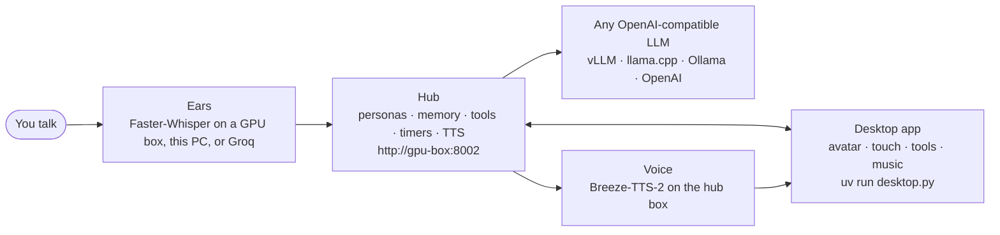

<picture>
  <source width="100%" srcset="./docs/banner-dark.png" media="(prefers-color-scheme: dark)" />
  <source width="100%" srcset="./docs/banner-light.png" media="(prefers-color-scheme: light), (prefers-color-scheme: no-preference)" />
  
</picture>

<h1 align="center">AI Desktop Assistant</h1>

<p align="center">
  <b>A voice companion that lives on your desktop, sees your screen, and gets things done.</b><br />
  Talk to her out loud; she talks back with her own voice through a lip-synced 3D avatar —
  and she can walk your desktop, react to touch, remember you, search the web, run commands,
  edit your notes and run your music.
</p>

<p align="center">
  
  
  
  <a href="LICENSE"></a>
</p>

> [!IMPORTANT]
> **This repo is a fork.** It is built on the free, open-source
> **[Project Riko](https://github.com/rayenfeng/riko_project) 50K snapshot** by
> [Rayen Feng](https://github.com/rayenfeng) (MIT-licensed), which remains the upstream.
> This fork is an independent project by **urbanslayer**: it is **not affiliated with,
> sponsored, or endorsed by the upstream author**.
> The upstream's paid Patreon products — **Full Source** and the **Desktop App** — are
> separate products and are **not** included or implied here; nothing in this repo is
> bought or supported through Patreon.
>
> Since the 50K snapshot, this fork has grown into something much larger — a shared hub,
> a full desktop pet, tools with permissions, touch, self-authored animations, Spotify
> control and more. The complete list is in **[docs/CHANGES.md](docs/CHANGES.md)**.

Upstream credit where it's due: the original concept, code and banner are Rayen Feng's —
you can follow his work on [GitHub](https://github.com/rayenfeng),
[YouTube](https://www.youtube.com/@JustRayen) or
[Patreon](https://patreon.com/RayenAI).

## What this is

The original Riko is a push-to-talk voice companion with a lip-synced VRM avatar: press
Enter, speak, she hears you (Whisper), thinks (any OpenAI-compatible LLM), answers out
loud (TTS) while her lips move. That core loop is intact here.

This fork restructures her around a **hub** — a small FastAPI server that owns her brain
(personas, memory, LLM settings, tools, timers, animations) — so any number of clients
share one head, and around a **desktop app** (PySide6) that makes her a real desktop
presence: a transparent, always-on-top avatar who can roam the bottom edge of your
screen, see your windows, type into apps, run commands, and play your music.



## What this fork adds

Summary — details and per-feature docs: **[docs/CHANGES.md](docs/CHANGES.md)**:

- **Architecture** — central hub on a GPU box shared by desktop/web/CLI clients;
  personas; chat history, long-term memory and facts; versioned schema with migrations;
  nightly backups. ([docs/DESIGN.md](docs/DESIGN.md), [docs/BACKUPS.md](docs/BACKUPS.md))
- **Desktop app** — PySide6 tray app with a floating transparent VRM window, a roam
  strip she walks along, scroll-to-resize, Super-free configurable shortcuts, fully
  offline vendored three.js/VRM libraries. ([docs/WALK_MEMORY.md](docs/WALK_MEMORY.md))
- **Voice** — remote ASR and hub-side TTS (per-persona designed/cloned voices),
  always-listen with VAD, an opt-in name gate, echo handling, speech-text rules that
  never read URLs aloud. ([docs/VOICE.md](docs/VOICE.md))
- **Embodiment** — gestures, emotions, gaze, walking, touch & posing (grab limbs,
  pats/pokes/tickles, sit on the screen edge), and animations she authors herself with
  preview/keep semantics, hold-aware keyframes and a pose cookbook.
  ([docs/BODY.md](docs/BODY.md), [docs/TOUCH.md](docs/TOUCH.md), [docs/SELF_ANIMATION.md](docs/SELF_ANIMATION.md))
- **Tools** — hub tool loop with per-tool permissions and a client-tool channel; MCP
  servers incl. Home Assistant; web search via SearXNG; weather; timers; desktop
  awareness across Hyprland/Sway/KDE/GNOME with compositor-safety rules; a Firefox
  extension; typing/dictation via ydotool; Obsidian/Kate editing; a policy-guarded
  `run_command` with natural-language recipes.
  ([docs/TOOLS.md](docs/TOOLS.md), [docs/DESKTOP_SENSE.md](docs/DESKTOP_SENSE.md), [docs/TYPING.md](docs/TYPING.md), [docs/COMMANDS.md](docs/COMMANDS.md))
- **Music** — Spotify Web API control, playing your own playlists and Liked Songs by
  name, a user-managed **Spotify Soloist** player with auto-update and ducking, and a
  now-playing ticker. ([docs/SPOTIFY_NOTES.md](docs/SPOTIFY_NOTES.md), [docs/SOLOIST.md](docs/SOLOIST.md))
- **Web config page** — one page on the hub for personas, brain, memory, voices, tools,
  MCP, timers, animations and chat. ([docs/API.md](docs/API.md))
- **Testing** — 2,300+ pytest tests, 170 node tests for the avatar page and the extension,
  and a headless visual QA harness that renders the real avatar and measures poses.
- **Docs** — every feature ships with a contract doc (see [docs/](docs/) and
  [docs/BACKLOG.md](docs/BACKLOG.md) as the feature map).

## Requirements

- **A box for her head** (any Linux machine on your LAN; a GPU box is ideal since her
  ears and voice usually live there too): Docker + docker compose for the hub,
  optionally the ASR and TTS stacks.
- **A desktop PC** (Linux for the desktop app — it needs a Wayland/X11 compositor for
  transparency and is developed on Hyprland, other compositors work with caveats; the
  terminal loop `main.py` + browser page also run on Windows): Python 3.11+ via
  [uv](https://docs.astral.sh/uv/), a microphone, speakers, `libportaudio2`.
- **An LLM**: any OpenAI-compatible server (vLLM, llama.cpp, LM Studio, Ollama, OpenAI).
- **Optional**: Spotify **Premium** + a Soloist API key for the managed music player;
  a SearXNG instance for `web_search`; a Home Assistant instance for smart-home
  control; Firefox + the bundled extension for browser tools; `ydotoold` for typing.

## Quick start

### 1. The hub (on the GPU box)

```bash
mkdir -p ~/AI/Docker/riko-hub && cd ~/AI/Docker/riko-hub
# copy this repo's hub/ folder here (e.g. rsync -a --exclude data/ <repo>/hub/ ./)
cp .env.example .env    # set RIKO_HUB_KEY, RIKO_LLM_BASE_URL, RIKO_LLM_API_KEY
docker network create riko   # once per host: shared network for hub + TTS
docker compose up -d         # builds the image on first run
```

Open `http://gpu-box:8002` (hostname or `192.0.2.x` address), paste the hub key, edit
her head. Env-var table: [`hub/README.md`](hub/README.md); API: [docs/API.md](docs/API.md).

Her **ears** (optional — `asr: local` works on the PC instead): `server/` is a
Faster-Whisper HTTP server, `docker compose up -d` in that folder (CPU variant:
`-f compose.yaml -f compose.cpu.yaml`). Her **voice** (optional): `tts/` deploys
Breeze-TTS-2 in Docker (see [`tts/README.md`](tts/README.md)); with it up, clients need
no TTS keys at all.

### 2. The desktop app (on your PC)

```bash
git clone https://github.com/urbanslayer/ai-desktop-assistant.git
cd ai-desktop-assistant
uv sync
cp .env.example .env        # RIKO_HUB_KEY (same value as the hub's), LLM_API_KEY, ...
```

Point `character_config.yaml` at your hub — `hub.mode: remote` + `hub.url:
http://gpu-box:8002`, or `hub.mode: local` to run the hub inside the app with no
Docker. Then:

```bash
uv run desktop.py      # the floating desktop avatar + tray (Linux)
uv run main.py         # or the terminal loop + browser page
uv run main.py --type  # no mic: type instead
```

**Private config: `character_config.local.yaml`.** `character_config.yaml` is tracked;
your machine-specific secrets and paths belong in a **`character_config.local.yaml`**
next to it. It is git-ignored and **deep-merged over** `character_config.yaml` (only
the keys you write are overridden), so updates to the tracked file never touch your
setup:

```yaml
# character_config.local.yaml — git-ignored, personal overrides only
hub:
  url: http://gpu-box:8002
asr.vocabulary: ["Riko", "senpai"]
listen:
  name_aliases: {riko: ["Riri"]}
```

### 3. Music (optional)

`desktop.music.player: soloist` is the default. Create your Soloist API key file —
generate the key at <https://developer.spotify.com/dashboard/soloist> (needs Premium),
then write it yourself, one line, mode 0600:

```bash
install -D -m 600 /dev/null ~/.config/riko/soloist.key
$EDITOR ~/.config/riko/soloist.key     # paste the key, save
```

Riko downloads the official Soloist binary from Spotify on first start and keeps it
fresh (builds expire after 90 days); pair the "Riko" device once from a Spotify app on
your LAN. Details: [docs/SOLOIST.md](docs/SOLOIST.md).

### 4. Firefox extension (optional)

`browser-ext/` is the "Riko Helper" MV3 extension (read-only tab awareness plus
risk-gated browser tools). Load it temporarily from `about:debugging` → *Load Temporary
Add-on*, or package it with `web-ext build`; the desktop app shows a link tab to pair
it. Behaviour and permissions: [docs/ROUNDS.md](docs/ROUNDS.md).

## Safety

- **`run_command` policy** ([docs/COMMANDS.md](docs/COMMANDS.md)): allowlisted read-only
  commands auto-run; anything else shows the exact command + working directory in an
  approval bubble. Never elevated (`sudo`/`su`/`pkexec` refused outright), never
  interactive, output and timeouts capped, environment scrubbed of API keys,
  secret-looking tokens masked before she sees them, paths like `~/.ssh` always ask.
- **She never starts, stops or controls your compositor or session** — `hyprctl`,
  `loginctl`, `systemctl poweroff` and friends are refused even with approval;
  workspace/app actions go through validated compositor dispatches and are verified
  against live compositor state before she claims success
  ([docs/DESKTOP_SENSE.md](docs/DESKTOP_SENSE.md)).
- **Typing into a terminal requires an explicit approval for the exact line she typed**
  (a one-time run token bound to window + command + 120 s expiry); a generic approval
  never unlocks Enter ([docs/TYPING.md](docs/TYPING.md)).
- **Per-tool permissions** (`always` / `ask me` / `never`) on the hub page apply to
  every tool incl. MCP servers; desktop-side levers (desktop awareness, touch
  reactions, dictation) are opt-in toggles, off until you turn them on.
- **The hub speaks plain HTTP with one bearer key — run it on a LAN or VPN, never
  directly on the internet** ([hub/README.md](hub/README.md#security)).

## Documentation

| Topic | Doc |
|---|---|
| Everything added vs upstream | [docs/CHANGES.md](docs/CHANGES.md) |
| Hub HTTP API reference | [docs/API.md](docs/API.md) |
| Hub design contract | [docs/DESIGN.md](docs/DESIGN.md), [hub/README.md](hub/README.md) |
| Tools, browser, MCP | [docs/TOOLS.md](docs/TOOLS.md), [docs/ROUNDS.md](docs/ROUNDS.md) |
| Voice (ASR/TTS, speech rules) | [docs/VOICE.md](docs/VOICE.md) |
| Embodiment / animation / touch / self-animation | [docs/BODY.md](docs/BODY.md), [docs/TOUCH.md](docs/TOUCH.md), [docs/SELF_ANIMATION.md](docs/SELF_ANIMATION.md) |
| Desktop awareness / commands / typing | [docs/DESKTOP_SENSE.md](docs/DESKTOP_SENSE.md), [docs/COMMANDS.md](docs/COMMANDS.md), [docs/TYPING.md](docs/TYPING.md) |
| Music (Spotify, Soloist) | [docs/SPOTIFY_NOTES.md](docs/SPOTIFY_NOTES.md), [docs/SOLOIST.md](docs/SOLOIST.md) |
| Timers / walk+memory / backups | [docs/TIMERS.md](docs/TIMERS.md), [docs/WALK_MEMORY.md](docs/WALK_MEMORY.md), [docs/BACKUPS.md](docs/BACKUPS.md) |
| Feature map | [docs/BACKLOG.md](docs/BACKLOG.md) |

Run the tests: `uv run pytest` (hub + desktop), `node --test client/js/` (avatar
page), `node --test browser-ext/test/` (extension).

## Credits & licence

- Original Project Riko code, concept and banner: **Copyright (c) 2025 Rayen Feng**,
  MIT — [github.com/rayenfeng/riko_project](https://github.com/rayenfeng/riko_project).
- Fork changes (everything in [docs/CHANGES.md](docs/CHANGES.md)):
  **Copyright (c) 2025-2026 urbanslayer**, MIT — see [LICENSE](LICENSE).
- Avatar rendering: [three.js](https://threejs.org) and
  [@pixiv/three-vrm](https://github.com/pixiv/three-vrm) (MIT), vendored offline under
  `client/vendor/` (see [client/vendor/README.md](client/vendor/README.md)).
- Voice: [Breeze-TTS-2.cpp](https://github.com/HoppouAI/Breeze-TTS-2.cpp) (weights and
  outputs non-commercial), plus upstream's GPT-SoVITS / Fish / OpenAI-style modes.
- Ears: [Faster-Whisper](https://github.com/SYSTRAN/faster-whisper), Groq.
- **Spotify Soloist** is downloaded by each user from Spotify's official server at
  runtime and is **not redistributed** in this repo.
- Sample avatar by [pixiv Inc.](https://github.com/pixiv/three-vrm)
  (VRM1_Constraint_Twist_Sample).

## License

[MIT](LICENSE) — original work Copyright (c) 2025 Rayen Feng; fork changes
Copyright (c) 2025-2026 urbanslayer.
